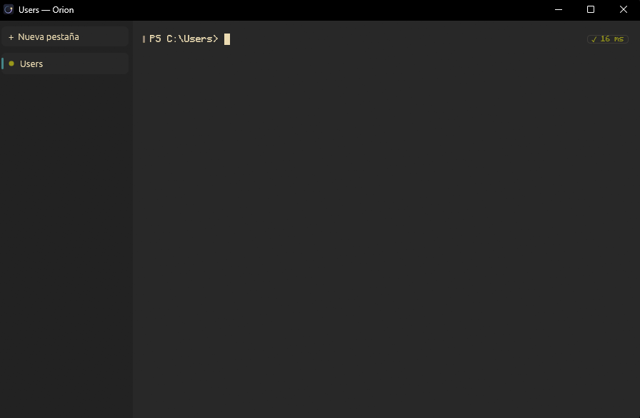
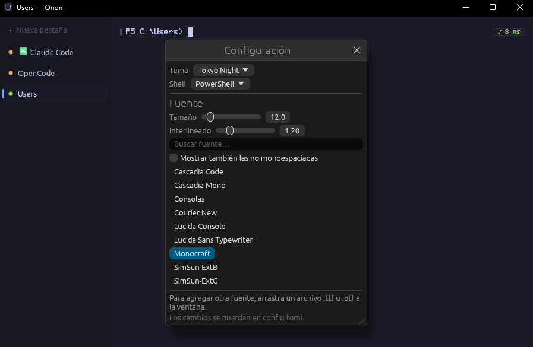

<p align="center">
  
</p>

<h1 align="center">Orion</h1>

<p align="center">Una terminal simple, rápida y bonita para Windows 11, escrita en Rust.</p>

---

Orion ordena tu trabajo en la terminal sin pedirte que aprendas nada nuevo: abres PowerShell como siempre,
pero cada comando queda en su propio **bloque**, con su resultado y lo que tardó a la vista.

<p align="center">
  
</p>

## Qué tiene

- **Bloques de comandos.** Cada comando y su salida forman un bloque, con una barra de color
  (verde si salió bien, rojo si falló) y una etiqueta como `✓ 120 ms` o `✗ 3 · 1.2 s`.
  Puedes copiar el comando o la salida de un clic, colapsar las salidas largas y saltar entre bloques con `Ctrl+↑` / `Ctrl+↓`.
- **Pestañas en una barra lateral**, con el nombre de la carpeta y un punto que te dice cómo terminó el último comando.
- **Paneles divididos** a la derecha o hacia abajo, cada uno con su propia shell.
- **Paleta de comandos** (`Ctrl+Shift+P`): busca cualquier acción por su nombre y aprende su atajo.
- **Sugerencias desde tu historial** mientras escribes; `→` las acepta.
- **Temas**: Tokyo Night, Catppuccin Mocha, Dracula, Gruvbox y Catppuccin Latte (claro).
- **Cualquier fuente**: las instaladas o un archivo `.ttf`/`.otf` arrastrado a la ventana.
- **Varias shells**: PowerShell, Windows PowerShell, cmd y WSL.
- **Terminal completa**: colores de 24 bits, mouse, apps de pantalla completa, selección y portapapeles.

## Instalar

1. Descarga `orion-<versión>-windows-x64.zip` desde [Releases](https://github.com/1Bnja/orion/releases/latest).
2. Descomprímelo donde quieras y abre `orion.exe`.

No instala nada ni necesita otros programas. Para borrarlo, borra la carpeta
(y si quieres, tu configuración en `%APPDATA%\orion`).

## Atajos

| Atajo | Qué hace |
|---|---|
| `Ctrl+Shift+P` | Paleta de comandos |
| `Ctrl+,` | Configuración |
| `Ctrl+Shift+T` | Nueva pestaña (clic derecho en "+ Nueva pestaña" para elegir la shell) |
| `Ctrl+Tab` / `Ctrl+Shift+Tab` | Pestaña siguiente / anterior |
| `Alt+1` … `Alt+9` | Ir a esa pestaña |
| `Ctrl+Shift+D` / `Ctrl+Shift+E` | Dividir el panel a la derecha / hacia abajo |
| `Ctrl+Alt+←↑→↓` | Pasar al panel de al lado |
| `Ctrl+Shift+W` | Cerrar el panel (o la pestaña, si es el último) |
| `Ctrl+↑` / `Ctrl+↓` | Saltar al bloque anterior / siguiente |
| `Ctrl+C` | Copiar la selección o el bloque marcado; si no hay nada, interrumpir |
| `Ctrl+Shift+C` / `Ctrl+Shift+V` | Copiar / pegar |
| `→` | Aceptar la sugerencia (`F2` muestra varias en una lista) |

## Configuración

Todo se puede cambiar desde `Ctrl+,` o editando `%APPDATA%\orion\config.toml`.
Los cambios se aplican apenas guardas el archivo, sin reiniciar.

<p align="center">
  
</p>

```toml
theme = "Tokyo Night"   # Tokyo Night, Catppuccin Mocha, Dracula, Gruvbox, Catppuccin Latte
shell = "PowerShell"    # PowerShell, Windows PowerShell, cmd, WSL

[font]
family = "Cascadia Mono"  # una fuente instalada, o la ruta a un .ttf/.otf
size = 14.0
line_height = 1.2         # 1.0 = líneas pegadas, 1.5 = muy espaciadas
```

Los bloques, el título por carpeta y las sugerencias funcionan en PowerShell.
En cmd y WSL Orion es una terminal normal.

## Compilar desde el código

Necesitas [Rust](https://rustup.rs) con el toolchain MSVC.

```powershell
cargo run                    # abrir Orion en modo desarrollo
cargo test                   # tests
.\scripts\package.ps1        # armar el zip portable en target\dist
```

Para publicar una versión: sube `version` en `Cargo.toml` y empuja un tag `v<versión>`;
GitHub Actions compila, arma el zip y crea la release.

### Cómo está hecho

| Pieza | Para qué |
|---|---|
| `portable-pty` | Lanza la shell en un pseudo-terminal de Windows (ConPTY) |
| `alacritty_terminal` | Interpreta las secuencias de la terminal y guarda la grilla de celdas |
| `eframe` / `egui` | La ventana y el dibujo |
| `serde` + `toml` | La configuración |
| OSC 133 | Marcas que la shell imprime en cada prompt y comando: así nacen los bloques |

El recorrido de los datos está explicado al comienzo de [`src/main.rs`](src/main.rs).
La planificación vive en el [tablero del proyecto](https://github.com/users/1Bnja/projects/6).

## Licencia

[MIT](LICENSE)
